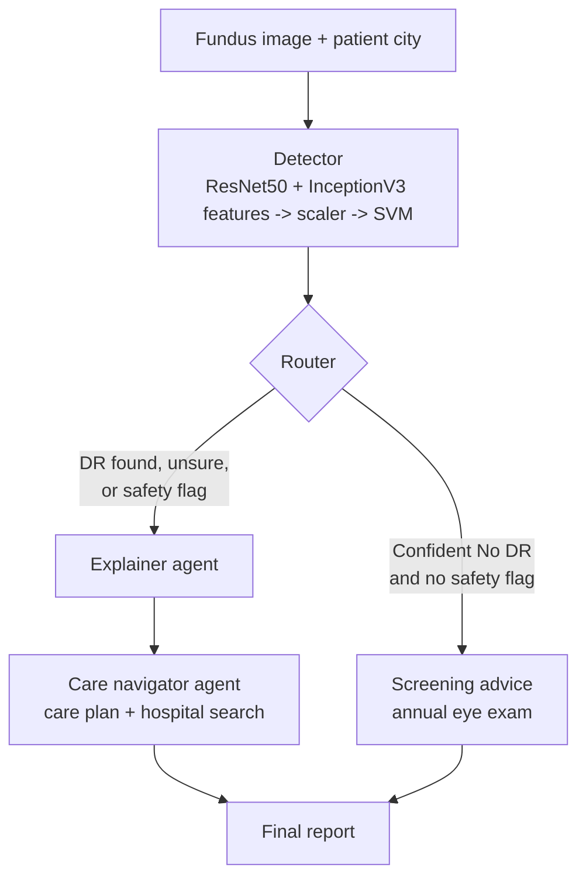

# Diabetic Retinopathy Screening with a Multi-Agent Assistant

An AI screening aid that looks at a retinal (fundus) photo, estimates the stage of diabetic retinopathy (DR), and then uses cooperating agents to explain the result in plain language and to guide the patient on where to go, what to keep in mind, roughly what it may cost, and how long recovery or follow-up may take.

> **Not a medical device.** This is a student/portfolio project. It screens, it does not diagnose. Every report tells the user to see a qualified ophthalmologist.

---

## 1. What the system does

| Step | Component | Type | Output |
|---|---|---|---|
| 1 | Detector | ML model (no LLM) | DR grade 0 to 4, confidence, class probabilities, safety flags |
| 2 | Router | Plain logic | Decides whether to stop with screening advice or continue |
| 3 | Explainer agent | LLM, grounded in stage facts | What the condition is, what it means, urgency, next steps |
| 4 | Care navigator agent | Map search + LLM, grounded in a care KB | Nearby eye hospitals, next steps, diet, high sugar/BP steps, reports to bring |
| 5 | Report | Template | One combined, plain-language report with a disclaimer |

The five grades follow the APTOS 2019 labels: **0 No DR, 1 Mild, 2 Moderate, 3 Severe, 4 Proliferative**.

---

## 2. Architecture



The pipeline is built with **LangGraph**: each box is a node that reads and writes a shared state (`image_path`, `city`, `grade`, `probs`, `explanation`, `hospitals`, `care_plan`, `report`).

---

## 3. The detection model

### Data
- **APTOS 2019** (Kaggle mirror `mariaherrerot/aptos2019`).
- Three official splits are used:
  - `train_1.csv` (2930 images): training
  - `valid.csv`: choosing models and thresholds
  - `test.csv`: final score, **used once**
- The class mix is imbalanced (roughly half are No DR), so accuracy alone is misleading.

### Pipeline
1. **Preprocessing:** resize to 256x256, median blur (3x3), CLAHE on the L channel of LAB, convert to RGB.
2. **Feature extraction:** frozen ImageNet **ResNet50** and **InceptionV3** (global average pooling, 2048 values each), each with its own `preprocess_input`, concatenated into a **4096-value hybrid vector**.
3. **Classifier:** `StandardScaler` + RBF **SVM** with `class_weight="balanced"`, tuned by 5-fold cross-validation using **quadratic weighted kappa (QWK)**. The final model has probability outputs enabled.
4. **Safety thresholds (chosen on the validation split):**
   - `T_SEVERE`: flag when P(Severe) + P(Proliferative) is at or above this value (target: catch about 90% of severe-or-worse cases)
   - `T_REFERABLE`: flag when P(Moderate) + P(Severe) + P(Proliferative) is at or above this value (target: catch about 95% of referable cases)
5. **Why thresholds, not just the top class:** an earlier run showed low recall for Severe and Proliferative (about 0.45 and 0.49), likely because they were being called Moderate. A false alarm sends someone to a doctor; a miss can cost sight. The thresholds trade extra false alarms for fewer missed serious cases.

### Baseline results from the original notebook (internal 80/20 split, before the fixes)

| Model | Accuracy |
|---|---|
| ResNet + Inception features, SVM (balanced, tuned for accuracy) | 81.2% |
| Same SVM tuned for QWK (C=10, gamma=0.001) | 80.9% (QWK 0.887) |
| ResNet features, neural network | 80.7% |
| Inception features, neural network | 76.8% |
| Inception features, SVM | 72.2% |

**Confusion matrix of the QWK-tuned SVM (internal 20% split, 586 images):** referable DR (Moderate or worse) was caught in 222 of 239 cases (92.9% sensitivity, 7.8% false alarms among non-referable). Severe or worse was caught in only 46 of 78 cases (59%): most missed cases were predicted as Moderate (16 of 31 Severe, 15 of 47 Proliferative). This is why the safety thresholds exist.

These numbers are **not comparable** with the fixed notebook, which uses the official validation and test splits. Re-run the notebook and record the new validation and test numbers (accuracy, QWK, per-class recall, referable sensitivity) here.

---

## 4. The agents in detail

### Detector (tool, no LLM)
Runs the same preprocessing and feature extraction as training, then the saved pipeline. It returns the top class, its confidence, all five probabilities, and two flags: `urgent` (P(Severe or worse) over `T_SEVERE`) and `referable` (P(Moderate or worse) over `T_REFERABLE`). If a flag fires, the grade passed downstream is raised (to at least Severe for `urgent`, at least Moderate for `referable`) so the system never under-grades a possibly serious case.

### Router
Stops early **only** if the result is a confident No DR (confidence of at least 0.60) with no safety flag. Anything else, including low-confidence "No DR", goes to the explainer.

### LLM provider: Groq
Both LLM agents call the **Groq API** through `langchain-groq` (`ChatGroq`), using the `GROQ_API_KEY` environment variable (a local `.env` file is read automatically if the variable is unset). The model is set with `LLM_MODEL` (default `openai/gpt-oss-120b`); Groq retires and adds models regularly, so check the current list at <https://console.groq.com/docs/models> if a call fails. Prefer a normal instruct model: Groq reasoning models can return their thinking text in the answer, which would end up in the patient report.

**Privacy:** the retinal image never leaves your machine. Only text goes to Groq: the grade, probabilities, safety flags, the city name and the hospital search results.

### Explainer agent (LLM)
Receives the grade, probabilities, flags and a small **stage fact table** (summary, follow-up interval, usual treatment, recovery). It writes under about 250 words: what the condition is, what it means for vision, how urgent it is, and what the patient can do (glucose, blood pressure and cholesterol control, regular eye exams). It must state that this is an AI screening result and that macular swelling (DME) cannot be seen by this model and needs an OCT scan.

### Care navigator agent (tool + LLM)
- Searches for eye hospitals in the patient's city with a free **OpenStreetMap Nominatim** lookup. The LLM may only name hospitals that the search returned.
- Writes a plan covering: which places to call, what to bring (HbA1c and medication list), arranging an escort if pupils will be dilated, no driving afterwards, and when to seek emergency care (sudden vision loss, new floaters, a curtain over the vision).
- Adds the cost table only for referable grades (Moderate and worse): Eylea at ASG (₹39,900 per eye), Accentrix at ASG (₹29,450) and Renuka (₹27,000), an unnamed Renuka anti-VEGF at ₹13,000 full dose / ₹7,000 half dose, and PRP laser at ₹4,300 per session (ASG) or ₹3,000 per session for both eyes (Renuka). It also describes treatments with no supplied quote (focal/grid laser, corticosteroid, vitrectomy, glucose/BP/lipid control) **without** attaching a price.
- **No invented facts.** Hospital names and addresses come only from the OpenStreetMap search; clinical advice comes only from `care_kb.json` and `stage_kb.json`; prices come only from `cost_kb.json`. The LLM is told to quote only those figures and never to invent a price, discount or total. Every price is per the stated unit (one injection package per eye, or one PRP laser session) and excludes consultation, OCT scans, the procedure fee and follow-up visits.
- Paths are configurable: `STAGE_KB_PATH`, `CARE_KB_PATH`, `COST_KB_PATH`. The cost node never calls an LLM, and the report repeats the figures deterministically.

---

## 5. Repository layout

```
.
├── agents/
│   ├── graph.py                        # LangGraph assembly + CLI
│   ├── state.py                        # shared DR_State contract
│   ├── config.py                       # env-driven settings
│   ├── llm.py                          # shared Groq factory
│   ├── data/                           # stage_kb.json, care_kb.json, cost_kb.json
│   └── nodes/                          # detector, router, screen_only, explainer,
│                                       # caregiver, hospital_search, report
├── scripts/
│   ├── check_inference.py              # one-image real inference check
│   ├── check_folder.py                 # batch inference + distribution
│   ├── collect_results.py              # writes paste-ready results/ pack
│   └── inspect_bundle.py               # validate dr_svm_bundle.joblib
├── tests/                              # node and graph wiring tests
├── results/                            # generated result pack (not source)
├── Diabetes_Retinoplasty_fixed.ipynb   # data, features, model training, evaluation, SHAP/LIME
├── dr_svm_bundle.joblib                # generated by the notebook: scaler + SVM + thresholds
├── requirements.txt
└── README.md
```

### Notebook flow
1. Setup and data paths (Kaggle or Colab via `kagglehub`)
2. Preprocessing function and feature extractors
3. Hybrid features for `train_1.csv`, saved to `X_features.npy` and `y_labels.npy`
4. Hybrid features for `valid.csv` and `test.csv`, plus a near-duplicate leakage check
5. Baselines (neural networks, Inception SVM, Random Forest, SMOTE, XGBoost)
6. Hybrid SVM: grid search for QWK, validation report and confusion matrix
7. Safety thresholds, one test evaluation, and saving `dr_svm_bundle.joblib`
8. SHAP and LIME explanations

---

## 6. How to run it

### Install
```bash
# The detector needs TensorFlow + scikit-learn 1.6.1 (the version that saved
# the bundle), so use Python 3.11/3.12 for a dedicated environment:
brew install python@3.12
/opt/homebrew/bin/python3.12 -m venv .venv-ml
.venv-ml/bin/pip install -r requirements.txt

export GROQ_API_KEY=your_key_here          # free key from console.groq.com
# optional: choose the Groq model (names change, see console.groq.com/docs/models)
export LLM_MODEL=openai/gpt-oss-120b
```

### Train and save the model
Open `Diabetes_Retinoplasty_fixed.ipynb` (a GPU runtime helps for feature extraction) and run it top to bottom. At the end you should have `dr_svm_bundle.joblib`.

### Check the bundle and the detector
```bash
.venv-ml/bin/python scripts/inspect_bundle.py dr_svm_bundle.joblib
.venv-ml/bin/python scripts/check_inference.py path/to/fundus_image.png
.venv-ml/bin/python scripts/check_folder.py test_images --csv predictions.csv
```

### Run the agents on one image
```bash
.venv-ml/bin/python -m agents.graph path/to/fundus_image.png Kolkata
.venv-ml/bin/python -m agents.graph path/to/fundus_image.png Kolkata --report-out report.md
```
The city is used for the eye-hospital search.

### Run the tests
```bash
for f in tests/test_*.py; do PYTHONPATH=. .venv/bin/python "$f" || exit 1; done
```
The node and graph tests use fake model bundles, fake LLMs and fake HTTP
clients, so they run without TensorFlow, a Groq key or network access. They
work in the plain `.venv` as well as `.venv-ml`.

### Collect results for a report
```bash
.venv-ml/bin/python scripts/collect_results.py                  # ~1 min, all sections
.venv-ml/bin/python scripts/collect_results.py --limit 150      # larger batch
.venv-ml/bin/python scripts/collect_results.py --skip-llm       # no Groq calls
```
It writes `results/00_tests.md` through `results/06_pipeline_no_dr.md` plus an
index (`results/README.md`). Each file contains the exact command and its
captured output, ready to paste into a results section. It also saves the two
full reports and `results/batch_predictions.csv`. Use `--clean` to start fresh.

---

## 7. Safety design

- **Never reassure on weak evidence:** low-confidence "No DR" is not treated as healthy.
- **Escalate instead of under-grading:** probability thresholds can raise the grade, tuned to catch serious disease.
- **No invented facts:** hospitals come from a real search, and every price comes from a fixed table of hospital quotes (never from the LLM).
- **Honest limits in every report:** screening aid only, cannot see macular swelling, see an ophthalmologist.

---

## 8. Known limitations

- Trained and tested on **one dataset (APTOS)**; performance on other cameras and populations is unknown. External validation (for example IDRiD or Messidor) is still to do.
- Frozen ImageNet features at 256x256 probably lose small lesions; Mild and Severe grades are the weakest.
- The thresholds are tuned on a small number of severe validation cases, so they are noisy.
- Open-source models on Groq follow the "no invented facts" instructions less reliably than the strongest models, so the planned **safety validator** (Roadmap item 2) matters more here. Free-tier Groq also has rate limits.
- **Prices cover two hospitals only, and only the treatment itself.** `cost_kb.json` holds quotes from ASG Eye Hospital and Renuka for anti-VEGF injections (Eylea, Accentrix, and an unnamed anti-VEGF full/half dose) and PRP laser. Consultation, OCT scans, procedure fees and follow-up are excluded, and PRP usually needs several sessions, so none of these figures is a total treatment cost. Other treatments (focal laser, corticosteroid, vitrectomy) are described without any price because no quote was supplied. There is also no recovery-timeline table.
- Prices go stale: update `cost_kb.json` (or point `COST_KB_PATH` at a newer file) before showing them to anyone.
- OpenStreetMap results can be incomplete and carry no ratings or opening hours.
- The SHAP maps use a kNN-softmax surrogate and matched the SVM on only 23 of 30 test images in one run; LIME calls the real model and is more faithful.
- The detector was verified to reproduce the notebook's preprocessing and 4096-value features exactly, but on the bundled `test_images` sample the raw SVM output was skewed towards Moderate (about 77% of 120 images), and the saved `T_SEVERE=0.084` escalated about 65% of them to Severe. That is a calibration/domain-shift issue in the saved model, not in the inference code.

---

## 9. Roadmap

1. **Image quality gate:** reject blurred, dark or cropped photos and ask for a retake (not built yet).
2. **Safety validator:** check that every hospital and price in the report comes from the tool results and tables (not built yet).
3. **Better model:** larger input (384 to 512 px), black-border crop and Ben Graham enhancement, then fine-tune EfficientNet or ResNet, possibly as ordinal regression.
4. **Retrieval:** ground the explainer in short clinical guideline passages with citations.
5. **Memory across visits:** store scans over time and report progression.
6. **Human in the loop:** clinician confirmation for Severe and Proliferative results.
7. **Grad-CAM** on the fine-tuned CNN for faithful visual explanations.
8. **Delivery:** FastAPI endpoint, Streamlit or Gradio demo, Docker, tests, Bengali and Hindi output.

---

## 10. Tech stack

Python, TensorFlow/Keras (ResNet50, InceptionV3), scikit-learn (SVM, GridSearchCV), OpenCV, LangGraph, **Groq API** (LLM, via `langchain-groq`), OpenStreetMap Nominatim, SHAP, LIME.

## 11. Dataset credit

APTOS 2019 Blindness Detection (Asia Pacific Tele-Ophthalmology Society), via the Kaggle mirror `mariaherrerot/aptos2019`. Check the dataset's licence before redistributing images or models trained on it.
